# Books and Reviews

**Your personal library inside Obsidian.** Catalog every book as a note, rate it with a structured yes/no questionnaire, and get a transparent **ARL score (0–10)** with a configurable **star rating**. Keep your reading log, characters, quotes, covers and image galleries in the same place, see everything in a fast, sortable library list with progress bars and charts — and walk through your books in a **virtual bookshelf** where every book is a spine you can pick up and place wherever you like.


*The virtual bookshelf: every book is a spine you can pick up and place wherever you like*

> Interface languages: **English** and **Italian** (switchable in the settings, live, no restart).

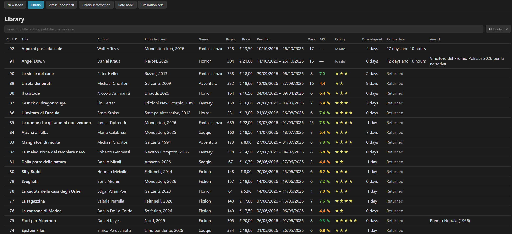

*The library: sortable list, coloured ARL scores, stars and a sticky totals bar*


---

## Table of contents

- [Features at a glance](#features-at-a-glance)
- [Installation](#installation)
- [Quick start](#quick-start)
- [The review system](#the-review-system)
  - [How the ARL score is computed](#how-the-arl-score-is-computed)
  - [Stars and thresholds](#stars-and-thresholds)
  - [Difficulty level of a set](#difficulty-level-of-a-set)
  - [Answering the questions: live ARL and current-question highlight](#answering-the-questions-live-arl-and-current-question-highlight)
  - [Manual rating](#manual-rating)
- [Evaluation sets](#evaluation-sets)
  - [Bundled sets](#bundled-sets)
  - [Managing sets in the plugin](#managing-sets-in-the-plugin)
  - [Set file format](#set-file-format)
  - [Score colours per set](#score-colours-per-set)
- [The library](#the-library)
- [Virtual library](#virtual-library)
  - [The idea](#the-idea)
  - [What you see](#what-you-see)
  - [Moving books and keeping your order](#moving-books-and-keeping-your-order)
  - [Saved arrangements](#saved-arrangements)
  - [Sorting buttons](#sorting-buttons)
  - [Virtual library options](#virtual-library-options)
- [Navigation](#navigation)
- [Book details](#book-details)
- [Reading progress, bar and chart](#reading-progress-bar-and-chart)
- [Characters, quotes and notes](#characters-quotes-and-notes)
- [Covers](#covers)
- [Image gallery](#image-gallery)
- [Loans and return dates](#loans-and-return-dates)
- [Settings](#settings)
- [Data model (what is stored in your notes)](#data-model-what-is-stored-in-your-notes)
- [Commands](#commands)
- [Keyboard and focus behaviour](#keyboard-and-focus-behaviour)
- [Building from source](#building-from-source)
- [License](#license)

---

## Features at a glance

- **One note per book**, with all data in the note's frontmatter: your library is plain Markdown, searchable, linkable and future-proof.
- **Structured reviews**: questions answered *Yes / No*, grouped by theme, each theme with its own weight.
- **ARL score 0–10** (weighted average of the themes) and **stars** derived from per-set thresholds.
- **Evaluation sets** (Novels, Essays, or your own): fully editable questions, themes, weights, star thresholds and colours. Sets are plain notes too.
- **Difficulty level** of each set (Easy → Very hard), computed from the probability of earning stars by answering at random.
- **Colour by score**: bars, ARL value and list take the colour of the score band, with optional gradients; the colours are configured per set.
- **Reading log** with page ranges per day, a **reading progress bar** showing pages read, total and **pages remaining**, and a **pages-per-day chart** (smooth gradient curve with tooltips).
- **Virtual library**: a bookshelf where every book is a coloured spine (colour by genre, thickness by number of pages, title, author and code on the spine). Drag books to place them, sort with one click, and save your favourite layouts as **named arrangements** you can always come back to.
- **Live ARL and stars** while you answer, and a coloured bar that highlights the **current question** (colours configurable).
- **Library list** with live search, status filter, sortable columns, configurable and re-orderable columns, sticky header and footer, exact scroll restoration, totals.
- **Image gallery** per book (thumbnails, actual-size viewer, optional **captions**), **characters**, **quotes/annotations**, **awards**, **price**, **return date** (loans), **covers** (from the vault, from your computer, or by link).
- **Library information window**: statistics on the whole library (longest/shortest books, reading periods, breaks between books, books per star rating and per genre…).
- **Full appearance control**: language, font family/size/colour, interface width, cover height, bar thickness and colours, chart style.
- Works on desktop and mobile (`isDesktopOnly: false`).
- **English and Italian** interface, switchable live.

## Installation

### From the community plugins (when available)

*Settings → Community plugins → Browse → search "Books and Reviews" → Install → Enable.*

### Manual installation

1. Download `main.js`, `manifest.json` and `styles.css` from the [latest release](../../releases/latest).
2. Create the folder `<your-vault>/.obsidian/plugins/books-and-reviews/` and copy the three files into it.
3. Reload Obsidian and enable **Books and Reviews** in *Settings → Community plugins*.

On first start the plugin creates the evaluation-set notes (in the language you selected) and the folders it needs.

Requires Obsidian **1.8.0** or later.

## Quick start

1. Click the **book icon** in the ribbon (or run the command *Open Books and Reviews*).
2. **New book** → fill in title, author, publisher/year, genre, pages, price, cover, dates.
3. **Rate book** → choose the book and a set (e.g. *Novels*) → answer the questions screen by screen.
4. Open the **Library** to browse, sort and search; click a book for its full detail page.

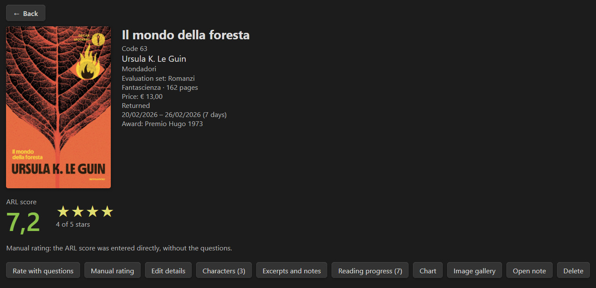

*The book detail page: ARL score, stars and one coloured bar per theme*


---

## The review system

The heart of the plugin is a questionnaire that turns your impressions into a number you can compare across books.

### How the ARL score is computed

1. A set is divided into **themes** (for example *Plot, Characters, Writing style, Setting, Emotions*).
2. Each theme contains a list of **yes/no questions** (the bundled sets have 10 per theme).
3. **Theme score** = `Yes answers × 10 / number of questions` → a value from 0 to 10.
4. **ARL** = weighted average of the theme scores, using each theme's **weight**, rounded to one decimal. Weights are normalised automatically (they don't have to sum to 100).

Example: Plot 9/10, Characters 9/10, Writing style 6/10, Setting 7/10, Emotions 4/10, equal weights → **ARL 7,0**.

The questions are shown a few at a time (1, 2, 5 or 10 per screen, configurable). You can go back, change answers, and re-open a review later with **Review again**.

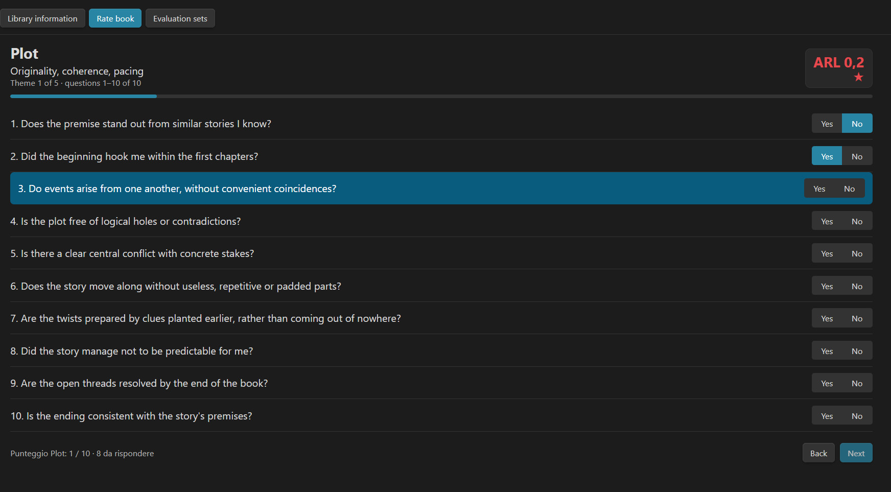

*The questionnaire: Yes / No questions with progress bar and Back / Next buttons, live ARL and stars at the top right, and the current question highlighted*


### Answering the questions: live ARL and current-question highlight

While you answer, two optional aids keep you oriented:

- **Live ARL and stars** — with *Settings → General → Live ARL and stars* on, the current **ARL score and the stars** appear at the **top right** of the questionnaire and update at every answer, coloured with the band colour of the score.

- **Highlight the question** — a coloured bar marks the **current question**: the first one on the screen that is still unanswered. It moves down as you answer, the page scrolls to keep it in view, and it disappears when every question of the screen is answered (the *Next* button then becomes available). If you go back and change an earlier answer, the bar stays on the first unanswered question.

  The highlight is on by default and is fully configurable in *Settings → General → Highlight the question*: switch it off, or choose the **background colour** (default green `#2e9e5b`) and the **text colour** (default white), each with a *restore default* button. A live **preview** shows the result and a note warns you when the two colours are too similar to be readable.

### Stars and thresholds

The ARL score is converted to stars with four **thresholds**: the maximum ARL that earns 1, 2, 3 and 4 stars (the fifth star runs from the 4-star limit up to 10).

| Preset | Thresholds | Character |
|---|---|---|
| **ARL scale** (default) | 3 / 5 / 7 / 9 | the original spreadsheet scale |
| **Linear** | 2 / 4 / 6 / 8 | evenly spaced |
| **Strict** | 5 / 7 / 8.5 / 9.5 | stars are hard to get |

Thresholds are stored **per set**, so a demanding set can be stricter than an easy one. The number of stars (1–10, default 5) is a global setting; with a total other than 5 the thresholds are redistributed proportionally. The ARL score always stays in the 0–10 range.

### Difficulty level of a set

Each set shows a **level**: *Easy · Accessible · Demanding · Hard · Very hard*. It answers the question *"how hard is it to get high stars with this set?"* and is computed exactly (not by simulation) from:

- the number of questions per theme and the weights,
- the star thresholds,
- the probability of each ARL score if every question were answered at random (50% Yes).

The bundled Novels and Essays sets are calibrated at the reference level. The editor shows the level live while you change questions, weights or thresholds, together with a table of the probability of reaching each star count.


### Manual rating

For books you don't want to go through the questionnaire (old reads, quick ratings), use **Manual rating**: type an ARL score from 0 to 10 and pick a set; stars, colours and statistics work as usual.  Manually rated books are marked with ✎ in the list.

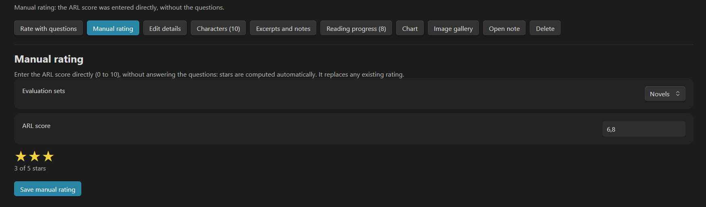

*Manual rating: type an ARL score and choose the set; the preview shows stars and colour*


---

## Evaluation sets

### Bundled sets

The plugin ships **no books**: your library starts empty and you add every book yourself. On first start it only creates the two ready-made sets below, in the language of the plugin. An empty library shows a short welcome with the first steps, and the **? Guide** button on the *Evaluation sets* screen opens a bilingual help on how to build your own sets.

| Language | Sets | Themes |
|---|---|---|
| English | **Novels** | Plot · Characters · Writing style · Setting · Emotions |
| English | **Essays** | Content and originality · Rigour and sources · Structure and clarity · Style and quality of the text · Usefulness and impact |
| Italian | **Romanzi** / **Saggi** | the same structure, in Italian |

Each bundled set has **5 themes × 10 questions** and equal weights. They live in the plugin source (`sets/en`, `sets/it`) and are written to your vault as notes the first time the plugin runs, **in the language you chose**. After that they are yours: edit them freely. *"Restore default Novels and Essays sets"* recreates them.

### Managing sets in the plugin

*Open → Evaluation sets*:

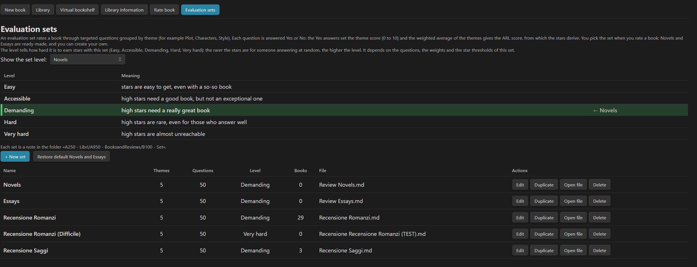

*The evaluation sets screen: every set with its difficulty level and the Edit / Duplicate / Open file buttons*


- **New set**, **Edit**, **Duplicate**, **Delete**, **Open file** (edit the note directly).
- Editor sections: name · **star thresholds** (with presets and a live preview of the star ranges) · **score colours** · **themes** (name, description, weight, drag-free reordering with up/down buttons) · **questions** (add, edit, remove, reorder).
- Live **difficulty level** and **total weight** feedback; validation with clear messages (repeated themes, empty themes, invalid thresholds, all-zero weights…).
- Renaming a set updates every book that uses it. Changing questions never alters the scores of books already rated (their answers are kept; you just can't review them with different questions).
- Invalid set notes are reported with the exact reason instead of failing silently.

### Set file format

A set is a Markdown note in the sets folder (default `Libri/ARL/Set`). You can write it by hand:

```markdown
---
tipo: set-domande-arl
nome: My thrillers
soglie: 3 / 5 / 7 / 9
colori: #e5484d / #f08c3a / #f5d142 / #8bc34a / #2e9e5b
---

## Plot
peso: 30
descrizione: Twists, pacing, coherence
- Did the twists surprise me without feeling arbitrary?
- Did the pacing keep me turning pages?

## Characters
peso: 20
id: characters
- Did I care what happened to the protagonist?
```

| Key | Meaning |
|---|---|
| `tipo: set-domande-arl` | marks the note as a set (required) |
| `nome` | name of the set (required, unique) |
| `soglie` | four increasing values between 0 and 10 (default `3 / 5 / 7 / 9`) |
| `colori` | five hex colours, one per score band (optional, see below) |
| `## Title` | starts a theme |
| `peso` | weight of the theme (relative) |
| `descrizione` | short description shown under the theme title |
| `id` | optional stable identifier of the theme (defaults to a slug of the name) |
| `- question` | a yes/no question (`* ` and `1.` list styles also work) |

> The keys keep their original (Italian) names regardless of the interface language, so sets and notes stay compatible between languages.

### Score colours per set

Every set defines **five score bands**, delimited by its star thresholds, and a colour for each:

```
Band 1   0 – 3     ■ red
Band 2   3 – 5     ■ orange
Band 3   5 – 7     ■ yellow
Band 4   7 – 9     ■ light green
Band 5   9 – 10    ■ dark green
```

(with thresholds 3 / 5 / 7 / 9 and the default palette). In the set editor, *Score band colours* lets you choose each colour with a colour picker, shows the live range of each band (it follows the thresholds), offers a **Try with score** slider with a live preview bar, and a **Restore default colours** button.

The colour of the band in which a score falls is used for:

- the **theme bars** in the book detail,
- the **ARL value** in the detail page, in the manual-rating preview and in the **library list**.

Two global options in *Settings → Score colours*:

- **Colour by score** (on/off),
- **Gradient bars across bands**: when on (default), a bar passes through the colours of the bands it crosses — a 4/10 bar goes red → orange, a 9/10 bar goes red → orange → yellow → light green → dark green; when off, the bar is a solid colour.

Existing sets without a `colori` line keep working with the default palette; the line is added only when you save the set from the editor.


---

## The library

*Open → Library* shows all your books in a table.

- **Live search** across code, title, author, publisher, genre, award and set.
- **Status filter**: all books · to be rated · rated.
- **Default order**: every time you open the plugin the list starts sorted by **Code, from the highest to the lowest**. **Click a header to sort**, click again to reverse. Sorting, search, filter and **scroll position are remembered** when you open a book and come back (the list returns to the exact row you left).
- **Sticky header and footer**: the title bar with search, the column headers and the totals bar stay visible while you scroll.
- **Footer summary** (one line, sticky): number of books and **total price** (€), **books per star rating** (5★, 4★, 3★ … plus books still to be rated), the **book with the most pages** and the **one with the fewest**, and the **top 5 genres** by number of books read — all computed on the filtered list. Each item can be switched on/off in *Settings → List totals bar*.
- **Library information** (button in the toolbar, after *Virtual library*): a window, laid out on two columns, with statistics on the whole library — the books with the most and fewest pages, the most expensive and cheapest, the longest and shortest reading period, the longest and shortest break between one book and the next, books per star rating (5★ … 1★ and still to be rated), books per genre, and the most and least read genre.
- **Configurable columns** (*Settings → List columns*): show/hide and **drag to reorder**. *Title* and *Author* are always visible. Available columns: Code, Title, Author, Publisher, Genre, Set, Pages, Price, Reading dates, Days, ARL, Rating (stars), Return, Time elapsed (days between the end of the previous book and the start of this one; hover to see the previous book), Award.
- ARL values are coloured by score band.
- The **Rate book** page uses the same list, with books still to be rated first.
- The toolbar at the top of the plugin reads: **New book · Library · Virtual library · Library information · Rate book · Evaluation sets**.

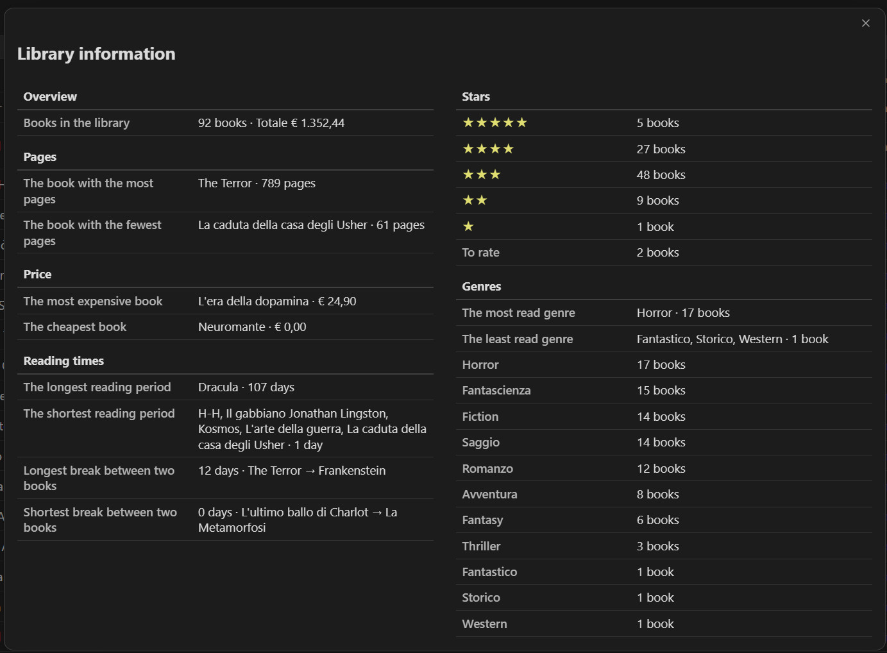

*The Library information window: statistics on the whole library on two columns*

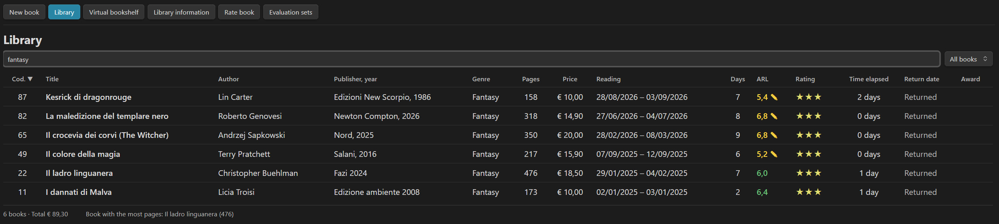

*Library toolbar: live search, status filter and sortable column headers*


## Virtual library

### The idea

The library list is perfect for **searching, sorting and counting**. The **Virtual library** answers a different need: to give your books a **material place**.

On a real shelf a book is not a row in a table — it is an **object with a body**: a thick spine or a thin one, a colour you recognise at a glance, a precise position next to other books. Where you put a book says something about you: the ones you love at eye level, the ones you read in the same season side by side, a saga kept together, the newest on the left. That spatial memory ("it's on the third shelf, between the green and the red ones") is something a list cannot give.

The virtual library recreates that experience inside Obsidian:

- **Every book becomes a spine**, standing on a wooden shelf, seen from the front like in a real bookcase.
- **The look of the spine carries information**: the **colour** tells you the genre, the **thickness** reflects how many pages the book has, the vertical text gives title and author, and the **code** sits at the bottom, horizontal, like a library label.
- **The position is yours**: you pick a book up with the mouse and put it somewhere else. The arrangement is saved and is there when you come back, so the shelf slowly becomes *your* shelf and not just another sorted view.
- **It is a complement, not a replacement**: the list stays the place for data work; the bookshelf is the place for browsing, remembering and arranging. Nothing you do on the shelf changes your notes — positions are kept in the plugin's own settings.

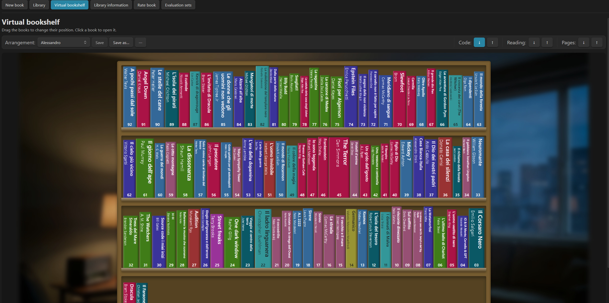

*The virtual library: shelves with coloured spines and codes, the one-row toolbar (arrangement and sorting) and the optional background image*

### What you see

Open it with the **Virtual library** button (right after *Library* in the toolbar) or the command *Virtual library*.

- **Shelves**: books are laid out left to right, shelf after shelf, from top to bottom. How many books fit on a shelf is a setting (5–40).
- **Spine colour = genre.** Each genre has its own colour, chosen in the settings. A genre without a choice gets an **automatic tint**, always the same for the same genre name; books without a genre are neutral grey. The text on the spine is white or dark, whichever reads better on that colour.
- **Spine thickness = pages.** Within a shelf, a book with more pages is thicker (a book with no page count gets an average thickness). The height varies slightly from book to book, like in a real bookcase, and shelves get taller as the library gets wider.
- **Spine text.** The **title** in bold and, below it, the **author**, rotated vertically as on a real spine. The font **shrinks by itself** so that the whole text fits — titles and authors are **never cut with “…”**. You can choose to show **title only** in the settings.
- **Code at the bottom.** The book's code is printed horizontally at the foot of the spine with at least two digits (`01`, `02`, … `75`, `120`); books without a code show nothing.
- **Hover.** The book lifts a little and a card shows the **title, author · genre, ARL and stars** (or *To rate*).
- **Click** opens the book's detail page.

**A wall behind the bookcase.** You can place an **image behind the shelves** — a wall, a room, a landscape — to give the bookcase a setting. The picture fills the area around the shelves (it is not visible *through* them, so the spines stay readable) and works together with the shelf background (wood or solid colour). Choose it in the settings (from the vault or from your computer), then tune how it is fitted (**Cover**, **Fit**, **Repeat**), how much it is **darkened** (0–70 %) and how **blurred** it is (0–20 px). Large photos use memory: keep them under about 2000 px wide.

### Moving books and keeping your order

- **Drag a spine** and drop it between two books: a coloured bar shows exactly where it will go (left or right of the book you are over). Drop it on the empty part of a shelf to put it at the end of that shelf.

- **Your arrangement is saved** (as a list of notes in the plugin's `data.json`) and restored every time you open the virtual library; you can also keep several named layouts, see [Saved arrangements](#saved-arrangements). Moving a book never touches your notes or codes.
- **Starting point**: with no saved arrangement the books are ordered by **code, from the highest to the lowest** — the same default order as the list. Books without a code go last.
- **New books** (or notes you rename) are not placed yet, so they appear **at the beginning**, ordered by code, until you move them.
- Changing *Books per shelf* simply **re-flows** the same order across the new shelves.
- Drag and drop is designed for the **mouse**; on touch screens it is less comfortable.

### Saved arrangements

Sorting and dragging are great for experimenting, but you may want to **keep an arrangement you like** and always be able to come back to it. That is what **arrangements** are: named layouts of the whole bookcase (for example *My library*, *Sagas together*, *Favourites on top*).

```
Arrangement: [ My library ▾ ]  ● modified   [Save] [Save as…] [Restore] [⋯]
```

- **Choose** an arrangement from the drop-down and the books are laid out exactly as you saved them. The last entry, **Free order (not saved)**, is just the working order.
- **Experiment freely**: when you drag a book or press a sorting button, the saved arrangement is **not changed**. A **● modified** mark appears next to the name.
- **Restore** goes back to the saved arrangement, discarding the experiments.
- **Save** overwrites the loaded arrangement with what you see now; **Save as…** creates a new one (it asks for a name — unique and not empty).
- The **⋯** menu lets you **Rename**, **Duplicate** and **Delete** the loaded arrangement (deleting asks for confirmation and leaves the books where they are).
- **When you open the virtual library** you find the **last arrangement you were using**, together with any unsaved work (still marked *modified*).
- **New books** appear at the beginning in every arrangement until you place them and save; a book whose note has been **deleted** simply disappears from the arrangements, with no gap. A renamed note counts as a new book.
- Arrangements are stored in the plugin's `data.json`, never in your notes.

### Sorting buttons

Above the shelves a toolbar lets you arrange the whole bookcase with one click:

```
Code: [ ↓ ] [ ↑ ]  │  Reading: [ ↓ ] [ ↑ ]  │  Pages: [ ↓ ] [ ↑ ]
```

| Group | ↓ | ↑ |
|---|---|---|
| **Code** | from the highest to the lowest (the starting order) | from the lowest to the highest |
| **Reading** (end-of-reading date) | from the most recent to the oldest | from the oldest to the most recent |
| **Pages** | from the book with the most pages to the one with the fewest | from the fewest to the most |

- Hover a button to read its meaning.
- The button of the **active sorting is highlighted**; as soon as you move a book by hand the highlight disappears, because the order is now yours.
- Books **without the value** (no code, no reading date, no page count) always go **last**; ties are resolved with the highest code first.
- The sorting is saved like a manual arrangement, and you can fine-tune it by dragging.
- On narrow windows the three groups wrap on several lines.

### Virtual library options

*Settings → Virtual library*:

| Option | What it does |
|---|---|
| **Books per shelf** | 5–40 books on each shelf |
| **Use the full width** | the bookcase takes the whole window width |
| **Bookshelf width** | width in pixels (500–2400) when *Use the full width* is off |
| **Text on the spine** | *Title and author* or *Title only* |
| **Image behind the bookshelf** | *Choose…* (vault) / *From computer…* / *None*; then **Image fit** (Cover · Fit · Repeat), **Darken the image** (0–70 %) and **Blur** (0–20 px) |
| **Bookshelf background** | **wood** by default, or any **solid colour** you pick (with a button to go back to wood) |
| **Colours by genre** | one colour picker for every genre found in your library, each with a *use the automatic tint* button |
| **Book order** | *Restore the order by code* (clears the working order; saved arrangements are kept): clears your saved positions and goes back to code, highest to lowest (asks for a second click to confirm) |

---

## Navigation

Every screen reached from the library has a clearly visible **← Back** button in the top left corner (detail page, image gallery, choice of the set). On the questionnaire the **Back** and **Next** buttons sit at the bottom. **Esc** goes back or closes dialogs without leaving the plugin.

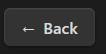

*The ← Back button in the top left of a book's detail page*

## Book details

Opening a book shows:

- the cover, title, author, publisher/year, genre, award, pages, price, dates, days of reading and return status;
- the **ARL score** (coloured), the **stars** (e.g. "2 of 5 stars"), and one **bar per theme** (coloured by band, with the score as `n / 10`);
- action buttons: **Review again**, **Manual rating**, **Edit data**, **Characters (n)**, **Quotes and annotations**, **Reading progress (n)**, **Image gallery (n)**, **Chart**, **Open note**, **Delete** (and **Mark as returned** for loans).

## Reading progress, bar and chart

Under **Reading progress** you log each session: **date + first page + last page**. The plugin derives:

- **Pages read, total pages of the book, pages remaining, days of reading and average pages per day**, shown as a summary line, for example *Total: 200 pages out of 305 · 105 pages remaining · 8 reading days · average 25 pages per day*. The **remaining pages** are counted from the **last page reached** (not from the sum of the sessions), so re-reading a page does not distort them;
- a **progress bar** (pages read vs. total pages) with configurable **thickness** and **colours** (solid or gradient), with a live preview in the settings;

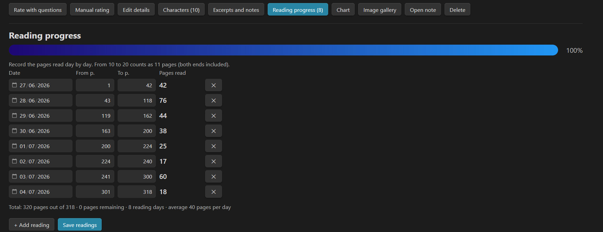

*Reading progress: the log of sessions (date, first and last page) with summary, pages remaining and progress bar*

- the **Chart** button (visible as soon as there is a log): a smooth **curve of pages read per day**, days on the horizontal axis and pages on the vertical axis, with gradient stroke, area, **tooltips** on hover, the same totals line (pages read, total, remaining, days, average) and a customisable colour pair, thickness and gradient on/off — again with a live preview in the settings.

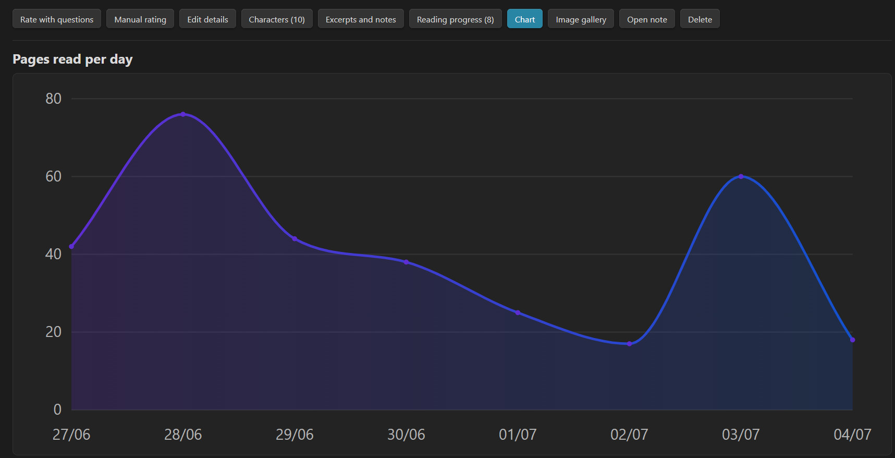

*The pages-per-day chart with gradient curve and tooltip*

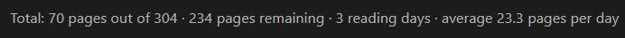

*The chart with its totals line: pages read, total, pages remaining, reading days and average*


## Characters, quotes and notes

- **Characters**: a name + description list per book (e.g. "Aragorn — the ranger"), saved in the note's frontmatter (`personaggi`, as `Name | description`) and in a `## Personaggi` section of the note body.
- **Quotes and annotations**: free Markdown text saved in the note body under a dedicated section, so you can also edit it in the normal Obsidian editor.
- Everything is plain Markdown in the book's note — **Open note** jumps to it at any time.

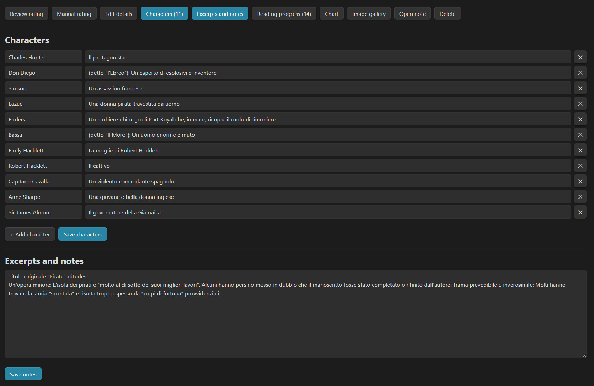

*Characters and quotes: the editing screens for a book*


## Covers

Three ways to attach a cover:

1. **Choose…** from an image already in your vault (with a picker and search);
2. **From computer…** upload an image — it is copied into the covers folder (default `Libri/ARL/Copertine`);
3. type a link such as `[[Covers/dune.jpg]]`.

The maximum cover height in the detail page is configurable (80–600 px) with a **reset** button to the default size.

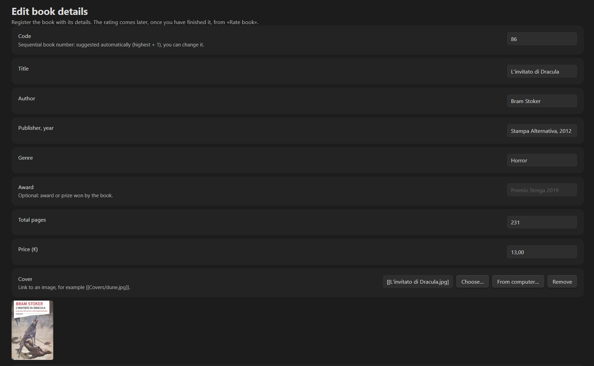

*Edit data: the cover field with "Choose…" and "From computer…" and the loan fields*


## Image gallery

The **Image gallery** button (next to *Reading progress*) opens a dedicated page with the themed images of a book — for example illustrations created with AI.

- Add images with the same interface used for covers: **Choose…** (from the vault) or **From computer…** (you can select **several files at once**; they are copied into the covers folder).
- Images appear as **large thumbnails** in a grid; the thumbnail width is set in *Settings → Image gallery* (120–600 px, with a reset to the default).
- **Click a thumbnail** to open it at **actual size** in a viewer: scroll for large images, **Fit** / **Actual size** toggle (also by clicking the image), **‹ ›** buttons or the **← →** keys to browse the whole gallery, **Esc** to close.
- The ✕ on a thumbnail removes it from the gallery without deleting the file.
- **Optional captions.** Under each image a small **✎** lets you add a short text (one line, up to 200 characters). If you don't write anything, **nothing is shown** under the image. The caption is also visible and editable in the actual-size viewer, below the image, and changes together with the image when you browse. Captions are saved with the image in the note (`galleria: "[[image.jpg]] | caption"`) and as an italic line under the embedded image.
- The gallery is saved in the note (`galleria` property and a `## Galleria` section with the embedded images), so the pictures are also visible in the normal Obsidian editor.

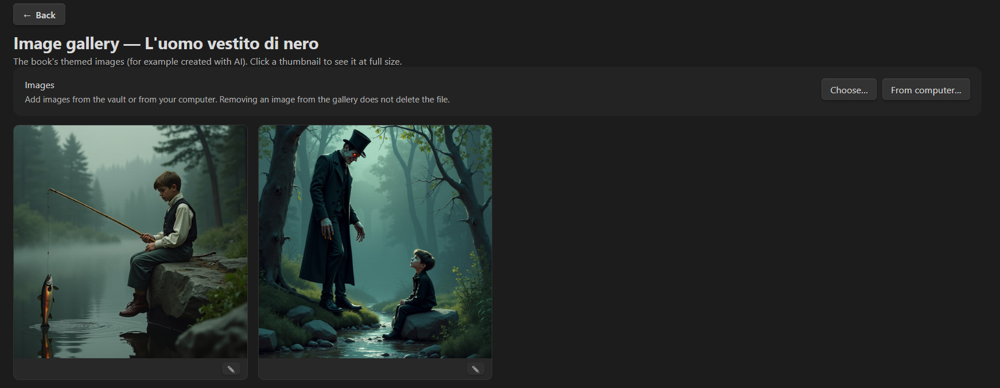

*The image gallery page: large thumbnails, optional captions under some images and the ✎ edit button*

## Loans and return dates

Set a **return date** and the plugin tracks it: the list and the detail show *time remaining* (months, days and hours), *Overdue by n days* in red, or *Returned* when you tick **Returned** / press **Mark as returned**. The deadline is the end of the chosen day.

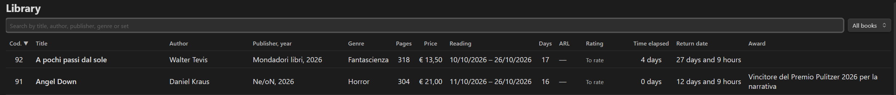

*Return column: time remaining until the return date*


---

## Settings

| Section | Options |
|---|---|
| **General** | Interface **language** (English / Italian) · **Save folder** for books · **Evaluation sets folder** · **Covers folder** · **Questions per screen** (1/2/5/10) · **Live ARL and stars** (shows the score and stars at the top right while you answer, updating at every answer) · **Highlight the question** (on/off, background colour, text colour, preview) · **Open full screen** (hides the Obsidian sidebars while the plugin is open, restores them on exit) · **Interface width** (600–2400 px, or full width) |
| **List totals bar** | Toggle each item: books and total €, books per star rating, most pages, fewest pages, genres read |
| **List columns** | Show/hide and drag-to-reorder every column |
| **Text** | **Font** family (theme default or a list of fonts) · **Font size** · **Text colour** |
| **Cover** | **Cover height** (80–600 px) with reset |
| **Image gallery** | **Thumbnail size** (120–600 px) with reset |
| **Reading bar** | **Thickness** · **Gradient** on/off · start/end **colours** · live preview |
| **Reading chart** | **Line thickness** (1–10) · **Gradient** on/off · start/end **colours** · live preview |
| **Score colours** | **Colour by score** · **Theme bar thickness** (4–30 px) · **Gradient bars across bands** |
| **Stars** | **Total stars** (1–10) |
| **Virtual library** | **Books per shelf** (5–40) · **Use the full width** / **width** (500–2400 px) · **Text on the spine** (title and author / title only) · **Background** (wood or solid colour) · **Colours by genre** · **Restore the order by code** |

Star thresholds, band colours, weights and questions are configured **per set** in *Evaluation sets → Edit*.


---

## Data model (what is stored in your notes)

Each book is a note with this frontmatter (all fields optional except the type):

```yaml
---
tipo: recensione-arl
codice: 42
titolo: Dune
autore: Frank Herbert
editore_anno: Ace, 1965
genere: Science fiction
premio: Hugo Award
pagine: 612
prezzo: 9.90
restituzione: 2026-11-30
restituito: false
inizio_lettura: 2026-09-01
fine_lettura: 2026-09-14
giorni: 14
copertina: "[[Covers/dune.jpg]]"
personaggi:                    # "Name | description"
  - "Paul Atreides | the young duke's son"
  - "Duncan Idaho"
letture:                       # "date | first page | last page"
  - "2026-09-01 | 1 | 40"
  - "2026-09-02 | 41 | 95"
galleria:                      # image link, optional " | caption"
  - "[[Covers/dune-1.png]] | Arrakis at dawn"
  - "[[Covers/dune-2.png]]"
set: Novels
arl: 8.2
valutazione_tipo: domande      # or: manuale
risposte_<theme>: SSNSSSNSSS   # S = yes, N = no
punteggio_<theme>: 8
---
```

The body of the note contains readable copies of this data in sections whose headings keep their original (Italian) names so notes stay compatible between interface languages: `## Personaggi` (characters), `## Estratti e annotazioni` (quotes and annotations), `## Letture` (reading table with *Date · From page · To page · Pages*), `## Galleria` (embedded images, with the optional caption in italics). **The frontmatter is the source of truth**: the plugin reads the reading log from `letture`, the characters from `personaggi` and the gallery from `galleria`, and regenerates the body sections when you save from the plugin.

The arrangement of the virtual library and the other preferences are **not** stored in your notes but in the plugin's `data.json`.

Everything lives in your vault as Markdown, so you can query it with Dataview, Bases, or any tool — and nothing is locked into the plugin. Plugin preferences are stored in `data.json` inside the plugin folder.


*A book note in Obsidian's normal editor: the frontmatter and the sections*


## Commands

All available from the command palette:

- **Open Books and Reviews**
- **New book**
- **Library**
- **Virtual library**
- **Rate book**
- **Evaluation sets**

(and the ribbon book icon).

## Keyboard and focus behaviour

The plugin keeps keyboard focus inside its own view: **Esc** closes dialogs, the actual-size image viewer or a caption being edited, or goes back inside the plugin without jumping to another note, and the focus is restored when you return to the tab.

## Building from source

```bash
npm install
npm run dev      # watch mode
npm run build    # type-check + production bundle (main.js)
```

The bundled sets in `sets/` are embedded into `main.js` at build time (esbuild text loader).

## License

[MIT](LICENSE) © Alessandro Vettorel
